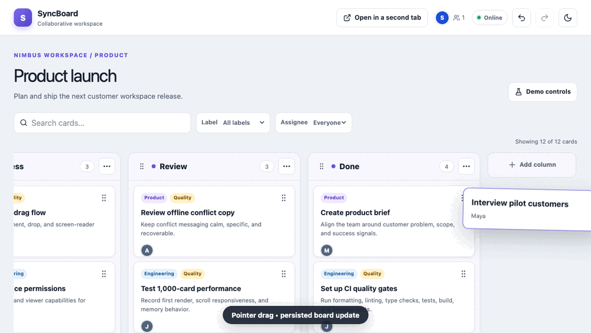
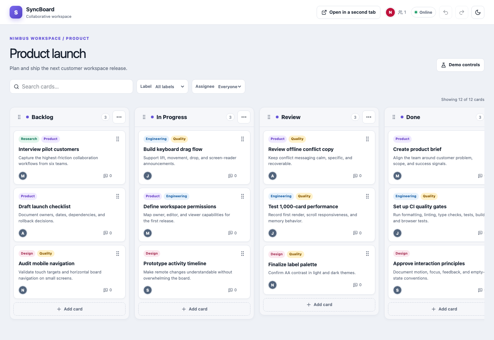
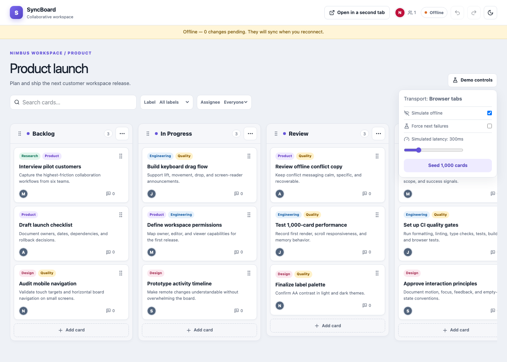
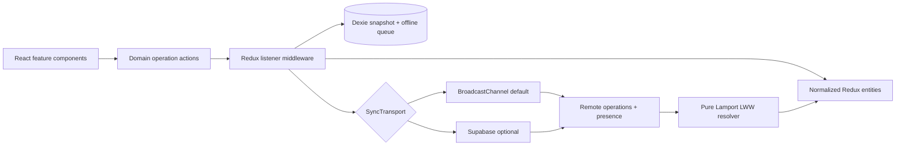

# SyncBoard

SyncBoard is a polished, offline-ready collaborative Kanban board built to
demonstrate production frontend architecture: normalized state, operation-based
realtime synchronization, optimistic updates, conflict handling, presence,
undo/redo, IndexedDB persistence, accessible drag and drop, and large-board
virtualization.

It works immediately without an account or API key. Open a second tab and both
boards synchronize through `BroadcastChannel`. Supplying Supabase environment
variables switches to the optional, lazily loaded internet-capable adapter without
changing the UI.







## Highlights

- Four realistic seeded columns and 12 fictional product-planning cards
- Pointer and keyboard drag for cards and columns, with a drag overlay and live
  screen-reader announcements
- Add, edit, delete, filter, and search workflows with an accessible card modal
- Optimistic updates with automatic rollback and an error toast on rejection
- Collaborative undo/redo using synchronized inverse operations
- Live avatars, 30fps cursor updates, and active-editor indicators
- Deterministic field-level last-writer-wins conflict resolution using Lamport clocks
- Ordered, de-duplicated IndexedDB queue with automatic reconnect replay
- BroadcastChannel and Supabase implementations behind one `SyncTransport` contract
- Memoized selectors, normalized entities, and automatic virtualization above 100
  cards per column
- Responsive light/dark UI, reduced-motion support, visible focus, semantic
  landmarks, and WCAG AA contrast
- A 20-second first-run tour and demo controls for latency, offline mode, injected
  failures, and an isolated 6,000-card stress test that can be loaded or cleared

## Architecture



Components dispatch domain operation drafts; they never call a transport. Redux
listener middleware turns each draft into a versioned operation, applies it
optimistically, records its inverse, saves the snapshot, and sends or queues it.
The runtime owns transport subscriptions and converts remote events into Redux
actions. This boundary makes the UI, persistence, and network implementation
independently testable.

### Folder structure

```text
src/
  app/                 Redux store and typed hooks
  data/                realistic fictional seed data
  features/
    board/             normalized entities, selectors, dnd, filters and UI
    history/           inverse operation generation and undo/redo state
    presence/          local identity, cursors and editing indicators
    sync/              operations, transports, persistence and conflicts
  shared/ui/           header, modal, tour, dev controls and toasts
tests/                 unit and component tests
e2e/                   Playwright workflows, axe and convergence tests
docs/                  README screenshots
```

## Sync, conflicts, and offline behavior

Every mutation is represented as:

```ts
{
  id,
  clientId,
  type,
  payload,
  baseVersion,
  timestamp,
  lamport: { counter, clientId }
}
```

The operation is applied locally before transport work, so the interface stays
responsive. Card and column entities keep a Lamport clock per editable field. A
remote field wins when its logical clock is newer; the client ID is a deterministic
tie-breaker. Overlap with a pending local field is detected by a pure function and
reported with the winning collaborator plus a recoverable Undo/Redo path, while the
card receives a short visual highlight.

When offline, operations remain applied locally and are inserted into Dexie with a
monotonic queue position. Reusing an operation ID replaces the old entry and moves
it to the newest position, providing deterministic de-duplication. Reconnect sends
the queue in order and removes only acknowledged operations. Both the normalized
board snapshot and queue survive reloads.

Undo creates and sends the inverse of the original operation, so it converges like
any other edit. Deleting a column captures its cards in a restore operation, and a
failed optimistic update discards its history entry before rolling back.

## Local development

Requirements: Node 22 and npm.

```bash
nvm use
npm install
npm run dev
```

Open the displayed Vite URL. Use **Open in a second tab** to see synchronization
without any setup.

### Commands

```bash
npm run dev             # local development server
npm run lint            # ESLint, including type-aware TypeScript rules
npm run typecheck       # strict TypeScript project build
npm run test            # unit and component tests
npm run test:coverage   # V8 coverage report
npm run e2e             # Playwright workflows and axe scans
npm run build           # production bundle
npm run preview         # serve the production bundle locally
npm run check           # format, lint, types, unit tests, and build
```

## Optional Supabase transport

Create `.env.local`:

```bash
VITE_SUPABASE_URL=https://YOUR_PROJECT.supabase.co
VITE_SUPABASE_ANON_KEY=YOUR_ANON_KEY
```

The runtime then loads and selects `SupabaseTransport`; otherwise it uses
`BroadcastChannelTransport` and does not download the Supabase client. The current
adapter uses Realtime Broadcast and Presence, which do not require an application
table. It is designed for communication across browser profiles and devices, but
this repository does not claim a hosted multi-device validation. If durable
server-side operation history is added later, this minimal table is a suitable
starting point:

```sql
create table public.syncboard_operations (
  id uuid primary key,
  board_id text not null,
  client_id text not null,
  operation jsonb not null,
  created_at timestamptz not null default now()
);

alter table public.syncboard_operations enable row level security;
alter publication supabase_realtime add table public.syncboard_operations;
```

Production authentication should be added before granting row-level policies; the
demo deliberately requires no account.

## Verification and measured metrics

Measured on the production Vite build in headless Chromium on 27 October 2026.

| Metric                      |                         Result |
| --------------------------- | -----------------------------: |
| Lighthouse Performance      |                             98 |
| Lighthouse Accessibility    |                            100 |
| Lighthouse Best Practices   |                            100 |
| Largest Contentful Paint    |                          1.8 s |
| Cumulative Layout Shift     |                              0 |
| Total Blocking Time         |                           0 ms |
| Default JavaScript bundle   | 456.67 kB raw / 147.97 kB gzip |
| Lazy Supabase chunk         |  225.37 kB raw / 59.13 kB gzip |
| CSS bundle                  |    23.30 kB raw / 6.23 kB gzip |
| Unit/component tests        |                     39 passing |
| Playwright workflows        |                     13 passing |
| Overall line coverage       |                         71.23% |
| `features/sync` coverage    |                         88.12% |
| `features/history` coverage |                         76.08% |
| First board render          |                         156 ms |
| 6,000-card load             |                         118 ms |
| 6,000-card scroll           |                         61 FPS |
| 6,000-card JS heap          |                        16.9 MB |
| Virtualized backlog DOM     |       4 of 6,003 cards mounted |

The browser suite covers drag persistence after reload, two-tab edits and presence,
offline queue recovery across reload, an explicit same-card offline conflict,
synchronized undo/redo, optimistic rollback, empty search and empty-column states,
mobile horizontal scrolling, light/dark axe scans, 6,000-card virtualization with a
bottom-card cross-column drag, and convergence after a deterministic mixed sequence
of 50 drags, edits, and synchronized undos across online and offline phases.
Separate Playwright contexts intentionally isolate browser storage, so the
cross-context test supplies a transport bridge. The production BroadcastChannel
adapter is verified across tabs/windows in one browser profile. The optional
Supabase adapter is designed for separate profiles and devices; a hosted
multi-device check remains deployment-specific and is not represented by these
automated results.

## Deployment

`vercel.json` provides SPA rewrites and immutable caching for hashed assets.

```bash
npm run check
npm run e2e
npm run build
npx vercel
```

In Vercel, keep the framework preset as **Vite**, build command as `npm run build`,
and output directory as `dist`. No environment variables are needed for the default
demo. Add the two Supabase variables only when cross-device realtime is required.

## Tradeoffs and what I would do next

- **Default scope:** BroadcastChannel gives a zero-setup demo but is limited to the
  same origin and browser storage partition. Supabase is the designed cross-device
  path and should be validated against the chosen hosted project before production.
- **Conflict model:** Field-level LWW is predictable and compact, but rich-text or
  true simultaneous editing would benefit from a CRDT such as Yjs.
- **Durability:** IndexedDB protects local work. A production version would append
  operations server-side, periodically compact snapshots, and support board history.
- **Virtualization:** The small custom fixed-height window avoids another dependency;
  variable-height cards would use TanStack Virtual with measurement caching.
- **Security:** The optional demo transport has no user accounts. Production would add
  Supabase Auth, board membership, row-level policies, rate limits, and audit logs.
- **Coverage:** Core reducers, ordering, conflicts, history, persistence, modal,
  keyboard drag, transport disconnects, offline replay, and runtime cleanup are
  unit-tested. The configured 70% line threshold prevents regression.
- **Bundle:** Supabase is a separate lazy chunk and downloads only when its build-time
  environment variables select that transport, keeping 225.37 kB of optional code
  out of the initial path.
